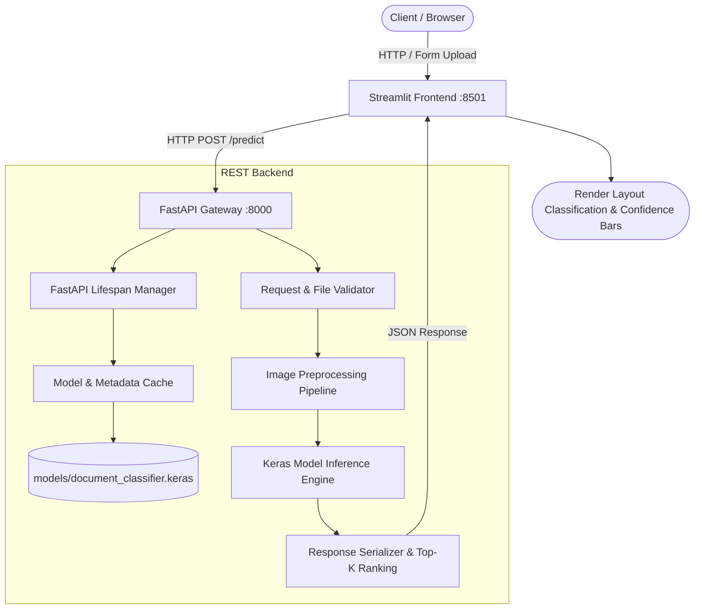

# System Architecture: Document Understanding & Layout Classification

This document details the architectural layout, component interactions, and dataflow of the Week 4 Document Understanding service.

---

## 1. Core Architectural Components

### 1.1 Web Presentation Layer (`frontend/app.py`)
Built with Streamlit, the presentation layer provides:
- **Interactive Preset Documents:** 5 pre-rendered document templates (Invoice, Receipt, Form, Letter, Report) allowing 1-click end-to-end testing without external files.
- **Custom File Upload:** Accepts `.png`, `.jpg`, `.jpeg`, `.tiff`, `.bmp`, and `.webp` with client-side format checking.
- **Explicit Inference Mode Selection (No Silent Fallback):**
  - *REST API (Microservice Mode):* Sends multipart requests to `http://localhost:8000/predict`. If the endpoint is offline or errors, an explicit error banner with troubleshooting guidance is displayed; no fabricated or synthetic results are rendered.
  - *Standalone Direct Model (In-Process Mode):* Evaluates the model directly in-process via `backend/model_utils.py` for testing or standalone execution. Every inference prominently displays its origin badge (`Source: REST API` or `Source: Standalone Direct Model`).
- **Explainability View:** Details the structural layout features detected by the model for the given category.

### 1.2 REST Gateway Layer (`backend/app.py` & `backend/routes.py`)
Built with FastAPI, the API gateway features:
- **Application Lifespan Cache:** Loads `document_classifier.keras` once during startup, caching weights in memory to avoid per-request disk I/O.
- **Strict Input Validation:**
  - Rejects unsupported extensions (e.g., `.txt`, `.exe`, `.pdf`) with HTTP 400.
  - Limits file payload to 10 MB.
  - Sanitizes corrupted byte streams using PIL header checks.
- **Structured Pydantic Schemas (`backend/schemas.py`):** Explicit typing for health status, error responses, prediction details, and top-k distributions.

### 1.3 Machine Learning Pipeline Layer (`training/`)
- **`generate_dataset.py`:** Generates layout-rich synthetic documents with characteristic geometric motifs (tables, headers, two-column layouts, receipts, signatures).
- **`preprocessing.py`:** Provides deterministic RGB conversion, aspect-ratio resizing to $224 \times 224$, and standardizes to float32 $[0.0, 255.0]$.
- **In-Graph Rescaling:** The model embeds `layers.Rescaling(scale=1.0/127.5, offset=-1.0)` as its first computation layer, guaranteeing ImageNet-standard MobileNetV2 preprocessing in range $[-1.0, 1.0]$ across training, evaluation, and API inference without pipeline mismatch.
- **`train.py`:** Trains a transfer-learning convolutional network with MobileNetV2 feature extractor and spatial classification head.
- **`evaluate.py`:** Computes held-out test evaluation, multi-class confusion matrices, and One-vs-Rest ROC/AUC curves.

---

## 2. Data Flow & Inference Lifecycle

1. **Request Ingestion:** The client sends a `multipart/form-data` POST request to `/predict` containing binary image data and an optional `top_k` integer.
2. **Format & Safety Check:** FastAPI inspects file suffix and MIME type against the allowlist.
3. **In-Memory Decoding:** Raw image bytes are deserialized into a PIL RGB object in memory; no temporary files are written to disk.
4. **Preprocessing:** PIL RGB image is resized to $224 \times 224 \times 3$, cast to float32 in $[0.0, 255.0]$.
5. **Model Forward Pass:** The model executes inference; its embedded `Rescaling(1.0/127.5, offset=-1.0)` maps inputs to $[-1.0, 1.0]$ before passing through the MobileNetV2 backbone, outputting a length-5 softmax probability vector.
6. **Postprocessing & Top-K Ranking:** Vector elements are mapped to category names, sorted in descending order of probability, and formatted into JSON response schema.
7. **Response Delivery:** Execution time is computed and returned alongside predicted category and confidence scores.
